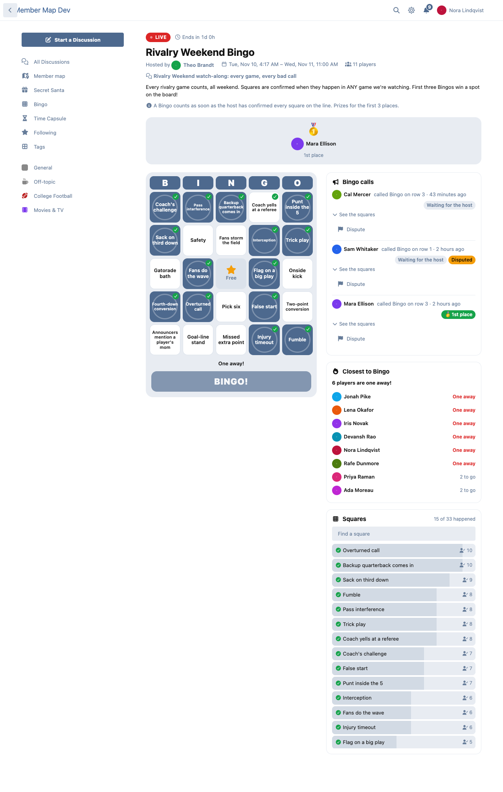

# Bingo

Play along with live events in your Flarum 2 community: the big game, the Super Bowl ads, a keynote, an awards show, a stream.

 [](https://packagist.org/packages/ernestdefoe/bingo)



- **Your own card.** A host makes a pool of 24 or more squares ("Fumble", "Puppy in an ad", "One more thing"), with an optional free center. Every member who joins is dealt their own shuffled 5×5 card from it. Cards are dealt on the server from a secret seed, so they're fixed and nobody can pick theirs.
- **Made for phones.** Big tap targets (over 60px on a 390px phone), a stamp when you mark a square, text that sizes itself so whole words fit, and finished lines that glow. The card opens over the discussion, so you can mark it without leaving the thread.
- **Bingo!** When a row, column or diagonal is complete the button wakes up. The server checks the call against your stored card and marks: the browser never decides a win.
- **Three ways to check calls.** Against squares the host confirms as they happen (a call counts the moment its last square is confirmed), the host checks each call, or the honor system. Other players can dispute a call; the host or a moderator accepts, rejects or keeps it.
- **1st, 2nd and 3rd.** Up to three places. Calls that became true at the same moment share a place, like a tie in a bingo hall. The game ends itself when every place is won.
- **In the watch-along thread.** Start a game from a discussion's controls. A strip under the title shows it live with your card one tap away, and the start, every call (with its standing, updated when it's ruled on) and the results are posted into the thread.
- **Live.** With flarum/realtime, open cards update the moment something happens. Without it, a cheap poll keeps them fresh (one cached number; your own taps cost nobody else a request).
- **The crowd.** See how many players marked each square, who is closest to Bingo, and "7 players are one away!"
- **A Bingo page** with live, upcoming and finished games, your own progress in each, and a winners board.
- **Ready-made packs** of squares for the Super Bowl ads, a football broadcast, a tech keynote, an awards show and a livestream.
- **Notifications** for the host (a call or a dispute to look at) and the player (your Bingo counts, or doesn't).
- **Permissions** to view, play, host and referee games. A game in a discussion is exactly as visible as that discussion.
- **GDPR**: with Flarum's GDPR extension, cards, calls and disputes are part of a member's data export and are removed on erasure.

## Install

```sh
composer require ernestdefoe/bingo
```

## Update

```sh
composer update ernestdefoe/bingo
php flarum migrate
php flarum cache:clear
```

## Links

- [Packagist](https://packagist.org/packages/ernestdefoe/bingo)
- [GitHub](https://github.com/ernestdefoe/bingo)
